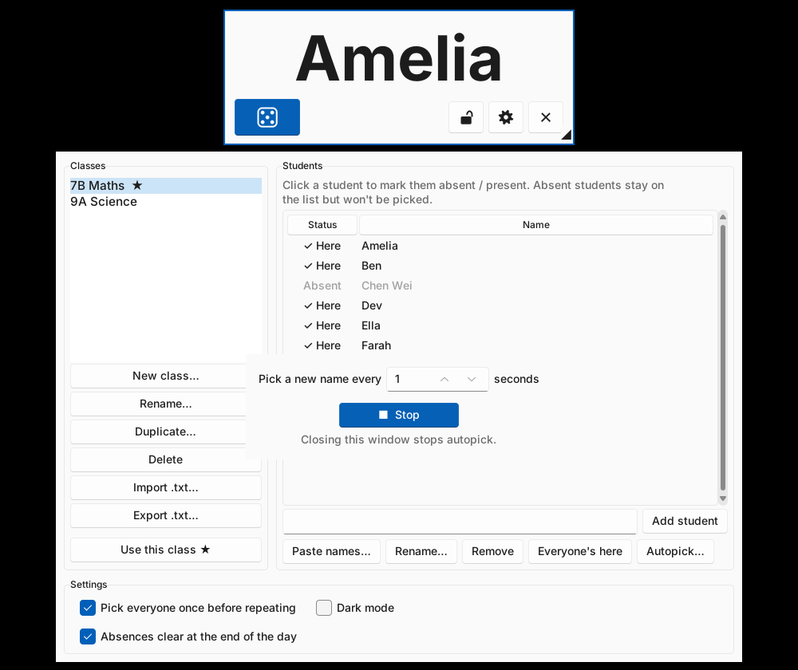

# 赢家 Yingjia

Name picking app, to be used in a classroom. Vibe-coded using Claude.

A free, offline random student picker for Windows classrooms, built as a
friendlier alternative to *No Hands*.



Dark mode: [screenshot-dark.png](screenshot-dark.png)

## What it does

- **Floating widget** that stays on top of every window (slides, browser,
  smart-board software). Shows just the picked name in large text, so the
  class can't see which list is in use. Drag the bottom-right corner to resize it; the name grows to fill
  the space, and long names shrink to fit.
- **Pick a name** with the **Tab** key or the dice button, which works well
  on a smart board. Tab works whenever the widget or the class manager is
  the active window (except while typing in a text box).
- **Autopick**: the "Autopick" button in the class manager opens a small
  window where you set the seconds and press Play to show a new name every
  few seconds. Pause keeps the countdown where it was; Stop resets it. Closing that window (or the class manager) always
  stops it, so it can't be left running by accident.
- **Fair picking**: by default everyone is picked once before anyone is picked
  again, and nobody comes up twice in a row. Can be switched to pure random.
- **Class manager** (⚙ button): create, rename, duplicate and delete classes;
  add, rename and remove students; paste a whole list at once; import and
  export the old one-name-per-line `.txt` files (UTF-8, UTF-16 and GBK all
  work).
- **Absent students**: click a student to mark them absent. They stay on the
  list, greyed out, and are never picked. By default absences clear
  automatically the next day, so nobody is forgotten. "Everyone's here"
  clears them all at once.
- **Lock** with **Ctrl+L** (same as No Hands): the widget can't be moved or
  resized and the close and settings buttons are hidden. Press Ctrl+L again to unlock.
- Works with Chinese, English and accented names, mixed in the same list.
- **Help**: a simple step-by-step guide, with a full English
  version and a full Chinese version on separate tabs. It opens the first
  time the app starts and from the Help button in the class manager, and
  ships as two .txt files with the installer and USB downloads (source:
  `src/yingjia/guide.py`).
- **Windows 11 look** with light and dark mode (Settings in the manager),
  using the Sun Valley theme. The theme is packed inside the .exe, so it
  works offline.

## Privacy and safeguarding

- No network code at all. Nothing is uploaded, no accounts, no analytics.
- Class lists are saved in one file on the PC:
  `%APPDATA%\Yingjia\classes.json` (inside that teacher's own Windows profile).
- Portable mode: if a file called `portable.txt` is next to
  `Yingjia.exe`, data is saved in a `data` folder beside it instead
  (good for a USB stick). The portable zip download is already set up this
  way.
- Each save writes a temporary file first and keeps a `.bak` copy, so a power
  cut mid-save can't wipe the lists.

## Running from source

Needs Python 3.8+ with Tkinter (included in the normal Windows installer).

```
pip install -r requirements.txt   # optional: Windows 11 theme
python src/run.py
python -m unittest discover -s tests -v
```

## Building the .exe

Windows executables have to be built on Windows. The GitHub Actions workflow
in `.github/workflows/build.yml` does it on every push:

1. Runs the tests.
2. Builds `Yingjia-Setup.exe` (an installer that adds desktop and Start
   menu icons, no administrator rights needed) and `Yingjia.exe` with PyInstaller for Windows 10/11 (Python 3.12)
   and `Yingjia-Windows7.exe` for Windows 7/8 (Python 3.8).
3. Produces a USB (portable) zip for each, plus SHA-256 checksums.
4. When the number in `VERSION` changes on `main` (e.g. `1.0.0` to
   `1.0.1`), tags that version and publishes a GitHub Release with the .exe
   files as download links.
5. Optionally, also uploads everything to S3 with a bilingual
   download page, using GitHub OIDC (no AWS keys stored in GitHub).

To build by hand on a Windows PC:

```
pip install pyinstaller -r requirements.txt
pyinstaller --onefile --windowed --name Yingjia --paths src --collect-data sv_ttk src/run.py
```

## Hosting the download for China

The app itself runs offline, so hosting is only about getting the installer
onto the teachers' PCs once.

| Option | Reachable from mainland China | Effort | Notes |
| --- | --- | --- | --- |
| **S3 in Hong Kong (ap-east-1)** | Usually yes, reasonable speed | Low | **Fallback mirror.** No ICP filing needed. Region must be opted into. |
| S3 + CloudFront (global) | Works, but no mainland edge locations, can be slow | Low | Adds HTTPS on a custom domain; little speed gain for China. |
| AWS China (Beijing / Ningxia) | Best | High | Separate AWS China account run by Sinnet/NWCD, needs a Chinese business licence and an ICP filing for a public site. Only worth it if the school or a Chinese partner owns the account. |
| GitHub Releases | Sometimes slow or blocked | None | **Starting point.** Already set up. Ask a teacher in China to test the link; add the S3 mirror if it fails. |

Suggested set-up (nothing has been created yet):

- One private S3 bucket in `ap-east-1`, with public read only on
  `index.html`, `latest/*` and `releases/*` (or a bucket website endpoint).
- An IAM role trusted by GitHub OIDC for this repository only, allowed
  `s3:PutObject` on that bucket.
- Repository variables `AWS_ROLE_ARN`, `AWS_REGION` (`ap-east-1`) and
  `S3_BUCKET`.
- Cost is pennies a month (a ~10 MB file and a small page).

Things to expect on school PCs:

- **Unsigned exe warnings**: Windows SmartScreen and Chinese antivirus
  (360, Huorong, Tencent PC Manager) may warn about a new unsigned program.
  A code-signing certificate removes most of this; until then, the checksums
  let IT staff verify the file.
- **Offline PCs**: download once on any networked machine and copy the
  portable zip over by USB.
